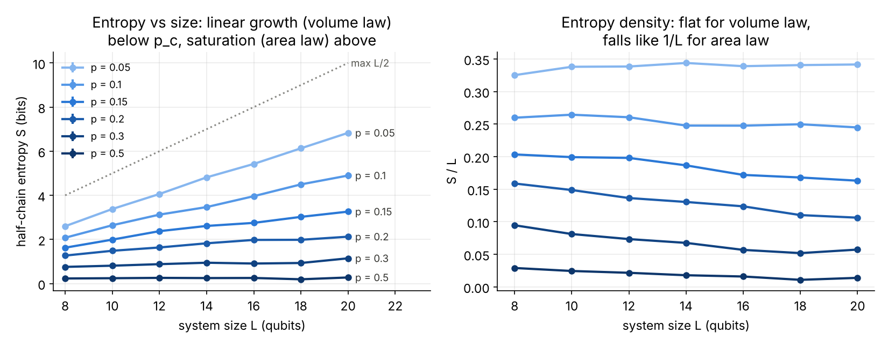

# mipt-sim

The measurement-induced phase transition (MIPT) in Haar-random brickwork circuits, simulated on a dense state vector in NumPy, with a [PennyLane](https://pennylane.ai) cross-check.

A chain of L qubits evolves under random two-qubit gates. Each qubit is also measured with probability p after every layer. Gates create entanglement and measurements destroy it. At low p, the half-chain entanglement entropy grows with L (a **volume law**). At high p it saturates (an **area law**, which in 1D means a constant). For Haar gates on qubits, the transition sits near p_c ≈ 0.17 ([Zabalo et al., arXiv:1911.00008](https://arxiv.org/abs/1911.00008)). For background, see [Li, Chen & Fisher, arXiv:1808.06134](https://arxiv.org/abs/1808.06134), [Skinner, Ruhman & Nahum, arXiv:1808.05953](https://arxiv.org/abs/1808.05953), and the review by [Fisher, Khemani, Nahum & Vijay, arXiv:2207.14280](https://arxiv.org/abs/2207.14280).

A guided tour with the circuit, both results and the distance decay from the paper is in [`examples/mipt_tour.ipynb`](examples/mipt_tour.ipynb).



**Result** (`scripts/sweep.py`, L = 8 to 20, 40 to 800 trajectories per point, error bars are one standard error, about the size of the markers). At p = 0.05 and 0.1, S grows linearly in L, with a constant entropy density S/L of about 0.34 and 0.25 bits per qubit (volume law). At p = 0.3 and 0.5, S stays flat at about 1 bit and 0.25 bit (area law). Between them, p = 0.15 and 0.2 grow slowly while S/L drifts down. That is what sizes this small look like near p_c ≈ 0.17, where S grows like log L. Locating p_c precisely needs a finite-size scaling collapse, as in Zabalo et al.

## Entanglement-weighted graphs

At the critical point, two distant regions are usually not entangled. An entanglement-weighted graph ([Lyu et al., arXiv:2602.04969](https://arxiv.org/abs/2602.04969), Sec. III B) averages the binary measurement record W(x, t) of each trajectory with weight equal to the entanglement it produced, Σ E·W / Σ E, which shows where measurements help or hurt. `scripts/ewg_run.py` samples L = 18, p = 0.17 with A = qubits (1, 2) and B = (8, 9) (1-based), and stores every record, its seed, and the negativity and log-negativity between A and B. Trajectory k uses seed k, so runs on different machines can be merged with `scripts/ewg_merge.py`. `scripts/ewg_plot.py` draws the negativity-weighted graph for the last 20 time steps.


**Result** (261,500 trajectories, of which about 15,500 entangle A and B; bootstrap uncertainty about ±0.006 per cell). Every trajectory is also counted mirrored, which swaps A and B and the brickwork parity, so circuits ending on even and odd layers enter half-half (`mipt_sim.ewg.symmetrized_graph`). A and B are rarely measured at the very end, while the qubits between them are measured about twice as often as p in the last two layers. Below that, a low-measurement bulk (about 0.16) joins A and B for roughly six time steps, and a halo of extra measurements (0.18 to 0.24) covers the far side of the ring. This is the bulk-and-halo structure of the paper's Fig. 6, which used Mølmer–Sørensen gates instead of Haar gates. With only 20,000 trajectories the bulk was lost in the noise.

## Model

The model matches `Repo/QuantumCircuit/randUnitaryMIstate.m`:

- L qubits (L even), periodic boundary conditions, starting from |0…0⟩.
- Brickwork layers alternate between bonds (0,1),(2,3),… and (1,2),…,(L−1,0). Every gate is an independent Haar-random 4×4 unitary.
- After every layer, each qubit is measured in Z with probability p. The outcome is drawn with the Born rule.
- The circuit has depth 2L layers. The half-chain von Neumann entropy (in bits) is averaged over trajectories and over two neighbouring cut positions. At large p, the entropy depends on whether the last layer acted on the cut bond, which gives an even/odd effect in L/2.

## Simulator

`mipt_sim.numpy_sim` keeps the state as a dense `(2,)*L` tensor. A two-qubit gate is one `np.tensordot` on two axes, about 4·2^L operations, with no layer matrix and no state permutation. A Z measurement zeroes half of the tensor and renormalizes, with the outcome drawn by the Born rule. It needs only NumPy (and `medt` for `region_entropy`), and porting it to a GPU is a matter of swapping NumPy for CuPy or JAX.

### Speed versus the MATLAB algorithm

Seconds per trajectory at p = 0.17, depth 2L, on a 4-core cloud machine (`scripts/benchmark.py`). Divide by 2L for the time per layer.

| L | `numpy_sim` | NumPy port of `randUnitaryMIstate.m` |
|---|---|---|
| 12 | 0.011 | 0.010 |
| 16 | 0.12 | 0.12 |
| 18 | 0.64 | 0.58 |
| 20 | 2.4 | 2.7 |
| 22 | 24 | 28 |

The two run within about 10% of each other. The port (`scripts/matlab_port.py`) runs the same steps as the MATLAB code: a Kronecker-product layer, a state permutation for odd layers, and a block projector. This table does not time MATLAB itself. For a direct comparison, run `tic; randUnitaryMIstate(20, 0.17, 20); toc` in MATLAB. Larger L or many more trajectories would need a GPU or batched trajectories, not a different CPU library.

## Why PennyLane is only a cross-check

The simulation needs one post-measurement state per trajectory. In exact (no-shots) mode, PennyLane's `qml.measure` does not provide one. Checked on PennyLane 0.45:

| `mcm_method` | what it does | per-trajectory entropy? |
|---|---|---|
| `deferred` | adds one ancilla qubit per measurement | no: entropy of the outcome-averaged state, and memory doubles with every measurement |
| `tree-traversal` | sums over all outcome branches | no: only averaged expectation values; `qml.state` and `qml.vn_entropy` are refused |
| `one-shot` | samples outcomes, needs `shots` | no: state-based measurements are refused with finite shots |

`default.clifford` behaves the same way. Applying the gates with PennyLane's own kernel (`qml.devices.qubit.apply_operation`) and measuring by hand works, but it was no faster than NumPy (2.6 s against 2.4 s at L = 20, and twice as slow at L = 12), so it was dropped.

What PennyLane does well here is exact outcome averages. `mipt_sim.pennylane_check.circuit_qnode` builds the same circuit with `qml.measure`, and `tests/test_mipt.py` checks that the Monte Carlo average over simulated trajectories reproduces PennyLane's tree-traversal expectation values. That test caught a bug in which some measurements were silently dropped.

## Possible next steps

- **A PennyLane contribution.** Let `one-shot` return state-based measurements (`qml.vn_entropy`, `qml.purity`, `qml.state`) for each shot. The device already holds the sampled post-measurement state, so the computation exists internally. A [forum thread](https://discuss.pennylane.ai/t/mid-circuit-measurement-with-qml-state/7491) asks about it.
- **Hardware-friendly probes** that need only shots and mid-circuit measurements, which is where PennyLane fits naturally: the reference-qubit purification probe ([Gullans & Huse, arXiv:1905.05195](https://arxiv.org/abs/1905.05195)) and the cross-entropy benchmark ([Li, Vijay & Fisher, arXiv:2209.00609](https://arxiv.org/abs/2209.00609)).
- **Clifford circuits** on `default.clifford` for L in the hundreds ([Li, Chen & Fisher, arXiv:1808.06134](https://arxiv.org/abs/1808.06134)), with the same mid-circuit limitation to work around.
- **Multipartite entanglement** of the steady state with `medt`. `region_entropy` already uses `medt.keep_systems`, and the next step is negativity and GMN of small subregions.

## Use

```bash
pip install git+https://github.com/liukeLyu/multipartite-entanglement-detection-toolkit   # install first: medt is a dependency and is not on PyPI
pip install -e .               # the simulator (NumPy only)
pip install -e ".[dev]"        # adds PennyLane (for the cross-check), pytest, ruff, matplotlib
pytest -q                      # 14 tests, a few seconds
python scripts/sweep.py        # writes results/sweep.json (about 15 min on 4 cores)
python scripts/plot.py         # writes results/entropy_vs_L.png
python scripts/benchmark.py 12 16 20
python scripts/ewg_run.py 20000                     # writes results/ewg_L18_p0.17.npz (about 1 h on 4 cores)
python scripts/ewg_run.py 200000 shard.npz 100000 12  # more samples: count, file, first seed, workers
python scripts/ewg_merge.py merged.npz results/ewg_L18_p0.17.npz shard.npz   # merges shards, dropping repeated seeds
python scripts/ewg_plot.py        # writes results/ewg_L18_p0.17.png
```

```python
import numpy as np
from mipt_sim import run_trajectory, half_chain_entropy

psi = run_trajectory(14, 0.1, np.random.default_rng(0))  # L = 14 qubits, p = 0.1
print(half_chain_entropy(psi))  # bits
```
