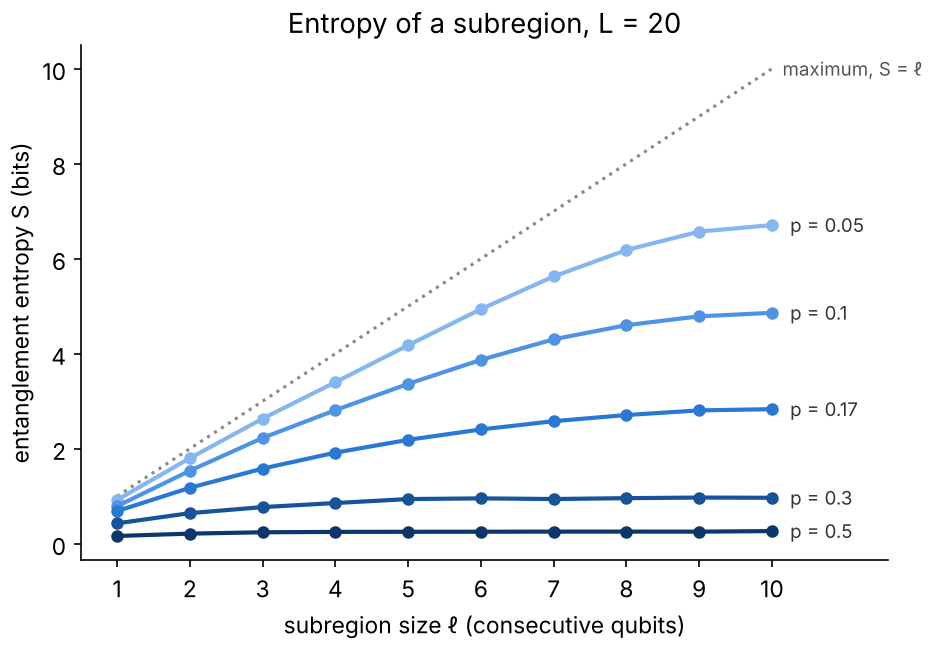
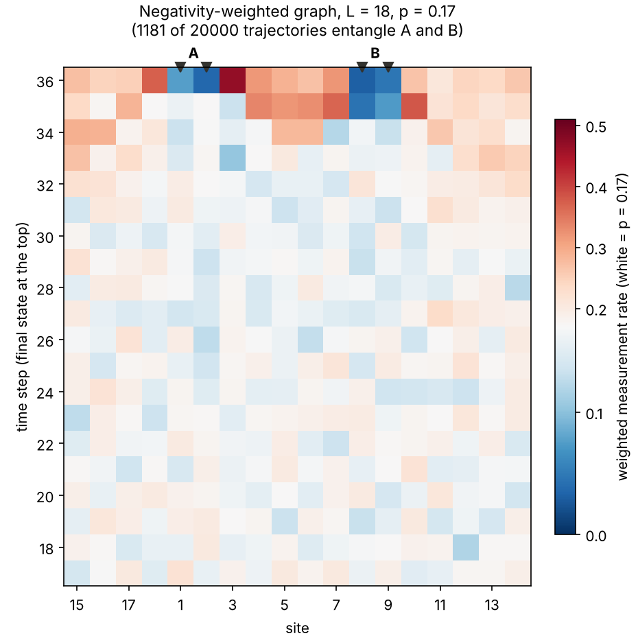

# mipt-sim

*Why I built this.* I wanted to make my paper on the measurement-induced transition ([Lyu et al., arXiv:2602.04969](https://arxiv.org/abs/2602.04969)) more accessible. More generally, the MIPT is a competition between two forces: local quantum gates entangle, and measurements disentangle. I find it interesting to ask what this means for quantum algorithms. What are the entanglement characteristics of a quantum algorithm?

The measurement-induced phase transition (MIPT), simulated with a small NumPy state-vector code.

## The idea

Take a ring of L qubits. At every time step, apply random two-qubit gates to neighbouring pairs of qubits, then measure each qubit with probability p. Look first at the two extremes.

- **No measurements (p = 0).** The whole circuit is one big random unitary. It entangles every qubit with every other, so the entanglement of a region grows with its size: a **volume law**.
- **Every qubit measured after every step (p = 1).** Each measurement collapses its qubit, and the state ends as a product state, a string of 0s and 1s with no entanglement.

In between, gates spread entanglement and measurements remove it. Below a critical rate p_c ≈ 0.17 the volume law survives. Above it, the entanglement of a region stays bounded however large the system is: an **area law**. For background, see the review by [Fisher, Khemani, Nahum & Vijay, arXiv:2207.14280](https://arxiv.org/abs/2207.14280), the original papers by [Li, Chen & Fisher, arXiv:1808.06134](https://arxiv.org/abs/1808.06134) and [Skinner, Ruhman & Nahum, arXiv:1808.05953](https://arxiv.org/abs/1808.05953), and [Zabalo et al., arXiv:1911.00008](https://arxiv.org/abs/1911.00008) for p_c.

A guided tour is in [`examples/mipt_tour.ipynb`](examples/mipt_tour.ipynb).

## The circuit

- A ring of L qubits (periodic boundary conditions), starting from |0…0⟩.
- Layers of Haar-random two-qubit gates in a brickwork pattern, alternating between bonds (1,2),(3,4),… and (2,3),…,(L,1).
- After every layer, each qubit is measured in Z with probability p, with the outcome drawn by the Born rule.
- 2L layers in total.

## Area law versus volume law



The entanglement entropy S of a block of ℓ consecutive qubits in a ring of L = 20, averaged over trajectories. At p = 0 it follows the curve of a random state, close to the maximum ℓ. At p = 1 it is zero. In between, at low p, S still grows in proportion to ℓ (volume law); at high p it saturates after a few qubits (area law); near p_c ≈ 0.17 it grows slowly, like log ℓ.

## Long-range entanglement

In ground states of gapped systems with local interactions, entanglement is short-ranged ([Lyu et al., arXiv:2412.12533](https://arxiv.org/abs/2412.12533)). At the critical point of the MIPT it is long-ranged: entanglement between two distant regions, averaged over trajectories, decays only as a power of their distance, roughly d^-8.8 for two parties, and faster for three or four ([Lyu et al., arXiv:2602.04969](https://arxiv.org/abs/2602.04969), Fig. 4).

## Where measurements create entanglement

Because of this steep decay, two distant regions are usually not entangled at all. An entanglement-weighted graph ([Lyu et al., arXiv:2602.04969](https://arxiv.org/abs/2602.04969)) shows which measurement patterns produce the rare cases that are. It averages the measurement record of every trajectory, weighted by the entanglement (negativity) it produced between regions A and B. White means measured at the usual rate p, blue less often, and red more often.



Here L = 18, p = 0.17, A = qubits (1, 2) and B = (8, 9). A and B themselves are almost never measured at the end. A low-measurement bulk joins them in the last time steps, while extra measurements just outside it, on the far side of the ring and between A and B at the very end, cut A and B off from the rest of the system. This is the same structure as Fig. 6 of the paper. Much of it follows from the [monogamy of entanglement](https://en.wikipedia.org/wiki/Monogamy_of_entanglement): the less A and B are entangled with everything else, the more they can be entangled with each other.

## Code

- `mipt_sim.numpy_sim` keeps the state as a dense `(2,)*L` tensor. Each gate is one `np.tensordot`, and each measurement zeroes half of the tensor. It needs only NumPy.
- `mipt_sim.ewg` computes the negativity weights and the weighted graph.
- [PennyLane](https://pennylane.ai) draws the circuit, and the tests check the simulator against PennyLane's exact averages over measurement outcomes. PennyLane cannot run the study by itself, because in exact mode it does not return the post-measurement state of a single trajectory.

## Use

```bash
pip install git+https://github.com/liukeLyu/multipartite-entanglement-detection-toolkit   # install first: medt is a dependency and is not on PyPI
pip install -e ".[dev]"        # the simulator, plus PennyLane, pytest, ruff and matplotlib
pytest -q
python scripts/subregion.py    # S versus subregion size at L = 20 -> results/subregion_L20.json
python scripts/plot.py         # -> results/entropy_vs_ell_L20.png
python scripts/ewg_run.py 20000   # sample trajectories -> results/ewg_records_L18_p0.17.npz (large, not committed)
python scripts/ewg_plot.py        # -> results/ewg_graph_L18_p0.17.npz (small summary) and results/ewg_L18_p0.17.png
```

```python
import numpy as np
from mipt_sim import interval_entropy, run_trajectory

psi = run_trajectory(14, 0.1, np.random.default_rng(0))  # L = 14 qubits, p = 0.1
print(interval_entropy(psi, 5))  # entropy of qubits 0-4, in bits
```
